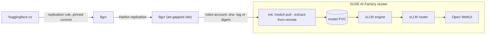

# 8gears blueprints for SUSE AI Factory

These blueprints run a chat assistant whose model weights come from your own
8gears Container Registry (8gcr) instead of huggingface.co. 8gcr is a Harbor
distribution that stores AI models as CNCF ModelPack OCI artifacts, next to
container images and Helm charts, so the model gets the same robot accounts,
audit log, retention and replication as your images. The cluster that runs
the model needs no access to huggingface.co.

| Blueprint CR                                                                                    | What it installs                                                                                         |
| ----------------------------------------------------------------------------------------------- | -------------------------------------------------------------------------------------------------------- |
| [`8gcr-governed-model-chat-0.1.0.yaml`](blueprints/8gcr-governed-model-chat-0.1.0.yaml)         | vLLM Production Stack and Open WebUI on a GPU node, serving Apertus-8B                                   |
| [`8gcr-governed-model-chat-cpu-0.1.0.yaml`](blueprints/8gcr-governed-model-chat-cpu-0.1.0.yaml) | The same setup on a node without a GPU, serving Qwen3-0.6B with the vLLM CPU build, for trials and demos |



All components run on SUSE AI Factory. Open WebUI is an example front end
and not part of 8gcr. Reused upstream work and licenses are listed in
[ATTRIBUTION.md](ATTRIBUTION.md).

## Components

| Component                                       | Source                                                | Role                                                        |
| ----------------------------------------------- | ----------------------------------------------------- | ----------------------------------------------------------- |
| `vllm-stack`                                    | `application-collection/vllm-stack` 0.1.13            | vLLM engine and router with an OpenAI-compatible API        |
| `fetch-model`, init container of the engine pod | `8gears.container-registry.com/library/modctl:v0.2.2` | streams the ModelPack artifact from 8gcr into the model PVC |
| `open-webui`                                    | `application-collection/open-webui` 8.19.1            | chat UI                                                     |

The CPU variant uses the upstream CPU build
`docker.io/vllm/vllm-openai-cpu:v0.33.0` as its engine image, because
Application Collection only ships a CUDA build.

## How it works

1. An 8gcr administrator adds a Hugging Face endpoint under
   Administration > Registries. The endpoint is source only and asks for
   a Hugging Face token, nothing else.
2. Under Administration > Replications, the administrator creates a
   pull-based replication rule with that endpoint as source. The rule
   names the model (for example `swiss-ai/Apertus-8B-Instruct-2509`), a
   revision (branch or tag), optional Include and Exclude file patterns,
   the destination project, and a manual or scheduled trigger. vLLM needs
   the weights, the config and the tokenizer files, so leave Include empty
   unless you know which files the model needs. Set
   Destination Repository Flattening to "No Flattening" to keep the
   organization in the path, as the blueprint defaults expect. Preview
   shows the Hub commit, the tags, the license, the matched files and the
   digest before anything is copied.
3. Each run resolves the revision to a Hub commit and stores the files as
   a ModelPack artifact. A rerun on the same commit with the same file
   patterns finds the artifact already there and skips it. With "Also tag
   each copy with its source revision" on, the artifact gets the tag
   `sha-<12-char commit>` next to the revision tag (for example `main`),
   which moves with the branch. The artifact page shows the source URL, the
   full source commit and the license. Pin the blueprint to the `sha-` tag or to the
   digest, never to the branch tag. A Harbor tag immutability rule for
   `sha-*` keeps anyone from moving the tag.
4. For an air-gapped site, a Harbor replication rule copies the model
   project to the 8gcr inside the site.
5. When the engine pod starts, the `fetch-model` init container runs
   `modctl pull --extract-from-remote` and writes the files to a directory
   named after the model and revision on the model PVC. modctl pulls the
   model with the optional Secret `8gcr-model-pull`.
6. vLLM loads that directory (`modelURL`) and serves it under the name set
   with `--served-model-name`. The engine runs with `HF_HUB_OFFLINE=1`, so
   any attempt to reach the Hub fails instead of passing unnoticed.
7. Open WebUI sends requests to the router at
   `http://vllm-stack-router-service/v1`.

The registry controls cover the model supply chain. They do not cover who
uses the chat: Open WebUI lets anyone who reaches the Ingress sign up, and
the vLLM API has no key. Set `ENABLE_SIGNUP=false` in Open WebUI and
`servingEngineSpec.vllmApiKey` in `vllm-stack` (with the same key as
`openaiApiKey` in Open WebUI) before you share the URL.

## Prerequisites

On the cluster:

- SUSE AI Factory with aif-operator 2.3.0 or later.
- SUSE Application Collection credentials configured in AI Factory.
- GPU variant: NVIDIA GPU nodes with the `nvidia` runtime class and at
  least 24 GB of VRAM. If your GPU nodes carry a taint, add a matching
  toleration under `servingEngineSpec.tolerations`.
- CPU variant: an x86_64 node with about 5 free CPUs and 10Gi of free
  memory (engine 4 CPU / 8Gi, plus router and Open WebUI).
- A default StorageClass whose volumes the modctl user (uid and gid 65532)
  can write to. The blueprints set `fsGroup: 65532`, which most CSI drivers
  apply.
- cert-manager.
- Network access from the cluster to your 8gcr.

In 8gcr:

- 8gcr 2.16.0 or later, which adds the Hugging Face import.
- The model, synced as described in "How it works".
- For private projects, a robot account that can pull from them.

The modctl image is public at
`8gears.container-registry.com/library/modctl:v0.2.2` (amd64 and arm64). It
is built from the modctl v0.2.2 source with the upstream `build/Dockerfile`
(`CGO_ENABLED=0`, distroless nonroot). The v0.2.2 release binary is linked
against glibc and panics in a distroless image when it looks up its own
user, and v0.2.2 predates the upstream image `ghcr.io/modelpack/modctl`.
Once modctl publishes that image, you can use it instead.

For a fully air-gapped cluster, the model is only one of the artifacts to
mirror. Copy the modctl image into your 8gcr as well and change
`initContainer.registry` and `initContainer.image`. The vLLM, router and Open WebUI images and charts come from
Application Collection, and the CPU engine image from Docker Hub, so they
need a mirror as well.

## Steps

### Register the blueprints

Add the partner catalog in AI Factory under Settings > Blueprint Catalogs >
Add Catalog: Repository URL `https://github.com/SUSE/partner-blueprints.git`,
Branch `main`, Paths `partners`. Both blueprints then appear in the
blueprint list.

### Run the workload

1. Choose the target namespace. For private projects, create the pull
   Secret in it before you install:

   ```shell
   kubectl -n <namespace> create secret docker-registry 8gcr-model-pull \
     --docker-server=<registry-host> \
     --docker-username='<robot-name>' --docker-password='<robot-secret>'
   ```

2. Install the blueprint. In the wizard, open the `vllm-stack` component's
   YAML and set the last `initContainer.args` entry (the model reference)
   to your 8gcr. Use the `sha-` tag or the digest for the model, for
   example
   `harbor.example.com/models/swiss-ai/apertus-8b-instruct-2509:sha-b946d40447b2`.
   For another revision, change the revision suffix in `--extract-dir` and
   `modelURL` too.
3. Wait for the engine pod. `kubectl -n <namespace> logs <engine-pod> -c fetch-model`
   shows the download. Apertus-8B is about 16 GB.

### Open the user interface

Point DNS for `governed-chat` (CPU variant: `governed-chat-cpu`) at the
ingress controller and open it in a browser. The model is listed under its
served name, `apertus-8b` or `qwen3-0-6b`.

## Customization

To serve another model, change the model reference, `--extract-dir`,
`modelURL`, `--served-model-name`, `toolCallParser` and the resource
requests together.

For a test against a registry with a self-signed certificate, add
`--insecure` to the init container arguments. In production, make the
cluster trust the registry's CA.

modctl can fetch through Dragonfly P2P with `--dragonfly-endpoint`. This is
untested with these blueprints.

## Cleanup

Uninstall the workload in AI Factory, then delete the namespace, which also
removes the model PVC. If you created the robot account only for this
blueprint, delete it in 8gcr.

## Test status

Tested on 2026-11-05 on a single node (8 vCPU, 32 GB, no GPU) with RKE2
v1.36.5, Rancher 2.15.3 and aif-operator 2.4.0:

- The CPU blueprint installed through AI Factory (Fleet HelmOps) from
  Application Collection, pulled a 1.4 GiB ModelPack artifact with modctl,
  and answered chat requests through the router and Open WebUI. The pod was
  ready 100 seconds after it started: 51 seconds for the download, 47 for
  the engine.
- A rerun on the same day pulled both the model and the modctl image from
  an 8gcr test instance with a pull-only robot account. A Hugging Face pull
  replication rule had copied `Qwen/Qwen3-0.6B` there in 140 seconds as
  `models/qwen/qwen3-0.6b:sha-c1899de289a0`. The init container fetched
  the 1.4 GiB in 33 seconds, and the pod was ready 90 seconds after it
  started.
- The GPU blueprint renders against the Application Collection chart but
  has not run on a GPU.
- Fleet shows the `vllm-stack` bundle as `Modified` while the workload
  runs. The vllm-stack 0.1.13 chart sets the label
  `app.kubernetes.io/managed-by: helm`, which Fleet removes on apply and
  then reports as drift. The pods are not affected.

## Support

8gears maintains this folder. Questions and issues: https://container-registry.com.
