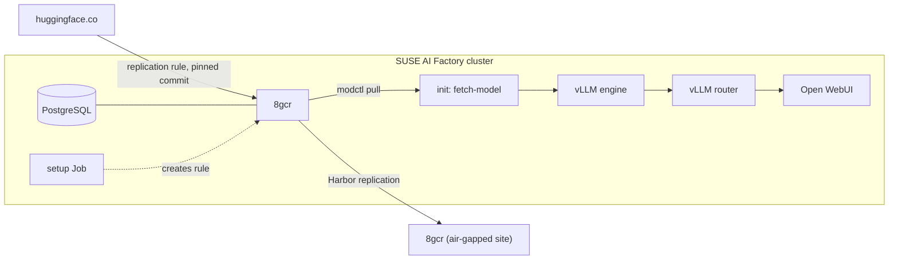

# 8gears Container Registry (8gcr) for SUSE AI Factory

The blueprint installs 8gears Container Registry (8gcr) on the AI Factory
cluster. 8gcr is a Harbor distribution that keeps container images, Helm
charts and AI models in one registry. Models are stored as CNCF ModelPack
OCI artifacts and get the same projects, robot accounts, audit log,
retention and replication as images. 8gcr copies them from Hugging Face
with a pull replication rule, pinned to the Hub commit, so the clusters
that serve them need no access to huggingface.co.

| Blueprint CR                                | What it installs                                                                        |
| ------------------------------------------- | --------------------------------------------------------------------------------------- |
| [`8gcr-0.1.0.yaml`](blueprints/8gcr-0.1.0.yaml) | 8gcr with PostgreSQL, and a model chat example (vLLM CPU build, Qwen3-0.6B, Open WebUI) |



The model chat is an example of what 8gcr is used for. Remove the
`vllm-stack` and `open-webui` components and the setup Job to install 8gcr
alone. Reused upstream work and licenses are listed in
[ATTRIBUTION.md](ATTRIBUTION.md).

## Components

| Component    | Source                                                             | Role                                                                                       |
| ------------ | ------------------------------------------------------------------ | ------------------------------------------------------------------------------------------ |
| `postgresql` | `application-collection/postgresql` 0.8.0                          | 8gcr database                                                                              |
| `harbor`     | `oci://8gears.container-registry.com/8gcr/charts/harbor` 2.1.2     | 8gcr: core, portal, registry, jobservice, exporter and Valkey; plus the example setup Job |
| `vllm-stack` | `application-collection/vllm-stack` 0.1.13                         | example: vLLM engine (CPU build) and router with an OpenAI-compatible API                  |
| `open-webui` | `application-collection/open-webui` 8.19.1                         | example: chat UI                                                                           |

The 8gcr images are a 2.16.0 pre-release, because the Hugging Face import
ships in 8gcr 2.16.0. The blueprint moves to the 2.16.0 release tag once
it is out.

## How it works

1. AI Factory installs PostgreSQL and 8gcr. 8gcr reads its admin
   password, encryption key and database password from the Secret `8gcr`.
2. The setup Job waits for 8gcr and creates, through the 8gcr API:
   - a public project `models` with a tag immutability rule for `sha-*`;
   - a Hugging Face endpoint (with `HF_TOKEN` from the Secret if set);
   - a pull replication rule for `Qwen/Qwen3-0.6B` at `main`, with
     "No Flattening" and "Also tag each copy with its source revision".

   Then it starts the rule. The run resolves `main` to a Hub commit and
   stores the files as a ModelPack artifact tagged `main` and
   `sha-c1899de289a0`. The artifact page shows the source URL, the commit
   and the license. The Job is idempotent.
3. The `fetch-model` init container of the vLLM engine runs
   `modctl pull --extract-from-remote` against the 8gcr Service inside the
   cluster (`harbor-core:80`, plain HTTP, no DNS or certificate needed).
   It fails and restarts until the copy exists. With the Kubernetes
   restart backoff, that can add up to 5 minutes after the copy is done.
4. vLLM loads the extracted directory with `HF_HUB_OFFLINE=1`, so any
   attempt to reach the Hub fails instead of passing unnoticed. Open WebUI
   talks to the router at `http://vllm-stack-router-service/v1`.

8gcr then works like any Harbor: add more Hugging Face rules under
Administration > Replications, push images and charts, create robot
accounts for other clusters, and replicate projects to 8gcr instances in
air-gapped sites.

The registry controls cover the model supply chain. They do not cover who
uses the chat: Open WebUI lets anyone who reaches the Ingress sign up, and
the vLLM API has no key. Set `ENABLE_SIGNUP=false` in Open WebUI and
`servingEngineSpec.vllmApiKey` in `vllm-stack` (with the same key as
`openaiApiKey` in Open WebUI) before you share the URL.

## Prerequisites

- SUSE AI Factory with aif-operator 2.3.0 or later.
- SUSE Application Collection credentials configured in AI Factory.
- An x86_64 node with about 7 free CPUs and 14Gi of free memory: 8gcr and
  PostgreSQL about 2 CPU / 4Gi, the vLLM engine 4 CPU / 8Gi, router and
  Open WebUI the rest. No GPU.
- A default StorageClass. The engine sets `fsGroup: 65532` so modctl can
  write to the model volume, which most CSI drivers apply.
- cert-manager.
- Outbound HTTPS to huggingface.co (8gcr only) and to
  8gears.container-registry.com (8gcr and modctl images).

## Steps

### Add the 8gcr chart repository

In Rancher, Apps > Repositories > Create: name `8gcr`, target "OCI
Repository", URL `oci://8gears.container-registry.com/8gcr/charts/harbor`.
The blueprint's `harbor` component refers to it as `chartRepo: 8gcr`.

### Register the blueprint

Add the partner catalog in AI Factory under Settings > Blueprint Catalogs >
Add Catalog: Repository URL `https://github.com/SUSE/partner-blueprints.git`,
Branch `main`, Paths `partners`.

### Create the Secret

In the namespace you will choose in the wizard:

```shell
kubectl create namespace <namespace>
kubectl -n <namespace> create secret generic 8gcr \
  --from-literal=HARBOR_ADMIN_PASSWORD='<admin-password>' \
  --from-literal=secretKey="$(openssl rand -hex 8)" \
  --from-literal=password="$(openssl rand -hex 16)" \
  --from-literal=postgresPassword="$(openssl rand -hex 16)" \
  --from-literal=replicationPassword="$(openssl rand -hex 16)"
```

`secretKey` must be exactly 16 characters. Add
`--from-literal=HF_TOKEN=<token>` for gated models or higher Hugging Face
rate limits.

### Install

Install the blueprint into that namespace. The defaults use the hosts
`8gcr` and `governed-chat`. To use your own, change `externalURL` and the
`ingress` hosts in the `harbor` component and `ingress.host` in
`open-webui`. Then point DNS for both names at the ingress controller.

Follow the progress with:

```shell
kubectl -n <namespace> logs job/8gcr-example-setup
kubectl -n <namespace> logs <vllm-engine-pod> -c fetch-model
```

### Use it

Open `https://8gcr` and sign in as `admin` with the password from the
Secret. The model is under Projects > models. Open `https://governed-chat`
for the chat; the model is listed as `qwen3-0-6b`.

## Customization

- **Another model:** change `MODEL` and `REVISION` in the setup Job, and in
  `vllm-stack` the model reference, `--extract-dir`, `modelURL`,
  `--served-model-name` and the resource requests. The `sha-` tag is the
  first 12 characters of the Hub commit, shown in the 8gcr replication
  preview.
- **GPU:** remove `registry`, `repository` and `tag` from the model entry
  so the chart uses its CUDA vLLM image from Application Collection, set
  `requestGPU: 1`, and remove `runtimeClassName: ""`, `--enforce-eager`
  and `VLLM_CPU_KVCACHE_SPACE`. Not tested on a GPU yet.
- **8gcr only:** remove the `vllm-stack` and `open-webui` components and
  the two `extraManifests` entries of `harbor`.
- **Other clusters:** create a read-only robot account in 8gcr and point
  their modctl init containers at the 8gcr Ingress with a pull Secret.
- **Air gap:** mirror the 8gcr, PostgreSQL, Valkey, vLLM, Open WebUI and
  modctl images and charts. Inside the site, replicate the `models` project
  from an 8gcr outside instead of from Hugging Face.

modctl can fetch through Dragonfly P2P with `--dragonfly-endpoint`. This is
untested with this blueprint.

## Cleanup

Uninstall the workload in AI Factory, then delete the namespace. That
removes the 8gcr registry volume, the PostgreSQL volume and the model
volume, and with them every image, chart and model stored in 8gcr.

## Test status

Tested on 2026-11-05 on a single node (8 vCPU, 32 GB, no GPU) with RKE2
v1.36.5, Rancher 2.15.3 and aif-operator 2.4.0, installed through AI
Factory (Fleet HelmOps), with the 8gcr chart from the OCI chart repository:

- PostgreSQL from Application Collection and 8gcr came up; 8gcr core was
  ready about 5 minutes after the install started.
- The setup Job finished in 5 seconds. The replication of
  `Qwen/Qwen3-0.6B` took 14 seconds and produced the same digest as
  earlier runs on other 8gcr instances (`sha256:abe67638…`).
- modctl pulled the 1.4 GiB artifact from the in-cluster 8gcr in 4
  seconds, after 8 restarts while it waited for the copy. vLLM was ready 50
  seconds later and answered chat requests through the router.
- The GPU setup has not run.
- Fleet shows the `vllm-stack` bundle as `Modified` while the workload
  runs. The vllm-stack 0.1.13 chart sets the label
  `app.kubernetes.io/managed-by: helm`, which Fleet removes on apply and
  then reports as drift. The pods are not affected.

## Support

8gears maintains this folder. Questions and issues: https://container-registry.com.
