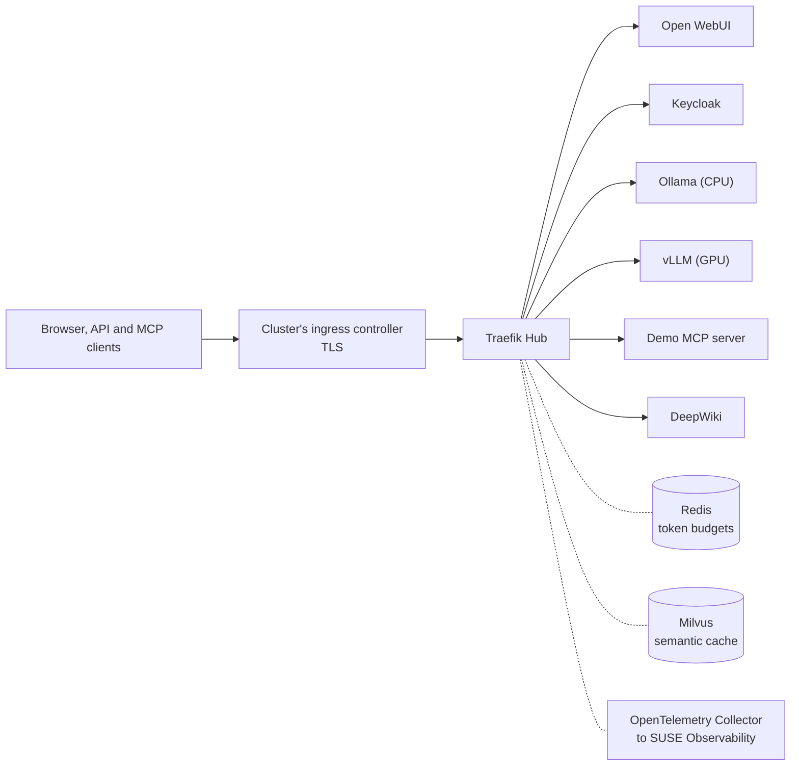

# Traefik Hub AI and MCP Governance Demo

`traefik-hub-ai-mcp-governance-demo` puts its own Traefik Hub in front of a SUSE AI
stack: Ollama, vLLM, Open WebUI, Milvus and Redis, with Keycloak sign-in. Traefik Hub
picks the models each group may use, caps their tokens, masks personal data, guards
prompts, controls MCP tools and fails over from vLLM to Ollama. Not for production.



Traefik Hub applies these policies:

- Every chat and MCP request needs a Keycloak token. Open WebUI forwards each user's
  token, so browser users get the same policies as API clients.
- Developers get `qwen2.5:0.5b`. Admins also get `smollm2:135m` and the vLLM model.
  Requests for the vLLM model fail over to Ollama.
- Token budgets per group and per user, and a semantic cache.
- Masking of personal data and secrets, and two prompt guards: `llama-guard3` and a
  jailbreak judge.
- MCP tools allowed per identity, with a rate limit per user.
- A WAF on the browser hosts. The chat and MCP routes reject request bodies
  containing U+017F and U+212A because some backends fold them into ASCII keys.
- Traefik sends traces, metrics and logs to the collector, which forwards them to
  SUSE Observability once you set its endpoint.

## Install

Check the [requirements of both blueprints](README.md#before-you-install). The
cluster needs cert-manager; the SUSE AI Factory installer includes it. Plan for
about 4 vCPU and 10 GiB of memory free on a node without a GPU. vLLM needs a node
with one NVIDIA GPU of 8 GB or more and the NVIDIA GPU Operator, and requests 4 CPU
and 16 GiB of memory on it.

1. Add Traefik's Helm repository once per cluster, as in
   [Before you install](README.md#before-you-install).
2. Get a Traefik Hub license key. Each install needs its own key. Request a trial at
   <https://info.traefik.io/traefik-hub-signup>.
3. In the wizard, open the `traefik` component's YAML, press Ctrl+F (Cmd+F on macOS),
   search for `domain:` and set:

   ```yaml
   global:
     blueprint:
       domain: <your domain>
       licenseToken: <license-key>
   ```

   No domain? Use `<node-ip>.traefik.me`, for example `203.0.113.10.traefik.me`. To
   keep the key out of the workload, create the Secret first and set
   `licenseSecret: true` instead of `licenseToken` (see
   [License key](README.md#license-key)).
4. Without a GPU, exclude the `vllm` component: Ollama then answers the requests for
   the vLLM model. Without SUSE Observability, exclude
   `suse-ai-observability-extension`.

The wizard proposes the namespace `traefik-hub-ai-mcp-governance-demo-system`. The
first start downloads about 10 GB of models and images.

## Use it

| Address | What |
|---|---|
| `https://chat.<domain>` | Open WebUI, with Keycloak sign-in |
| `https://ai.<domain>/v1` | The OpenAI-compatible API: `/v1/chat/completions` and `/v1/models` |
| `https://ai.<domain>/mcp/ai-factory` | The demo MCP server |
| `https://ai.<domain>/mcp/deepwiki` | DeepWiki |
| `https://keycloak.<domain>` | Keycloak, realm `ai-factory` |

Sign in as `admin@ai-factory.demo` first: the first user becomes the Open WebUI
admin. With the default issuer, the browser shows a certificate warning for
`chat.<domain>` and a second one for `keycloak.<domain>`: accept both, or import the
demo CA (Secret `demo-ca`). Use a private window for `dev@ai-factory.demo`.
Passwords: in Rancher, open Secret `keycloak-demo-users` in the demo's namespace, or
run this `kubectl` command:

```shell
NS=traefik-hub-ai-mcp-governance-demo-system
kubectl -n $NS get secret keycloak-demo-users -o jsonpath='{.data.admin}' | base64 -d; echo
kubectl -n $NS get secret keycloak-demo-users -o jsonpath='{.data.dev}' | base64 -d; echo
```

From the command line, save the CA, get a token from the `ai-factory-cli` client and
call the API:

```shell
kubectl -n $NS get secret demo-ca -o jsonpath='{.data.ca\.crt}' | base64 -d > demo-ca.crt
DOMAIN=<your domain>
DEV_PW=$(kubectl -n $NS get secret keycloak-demo-users -o jsonpath='{.data.dev}' | base64 -d)
TOKEN=$(curl -s --cacert demo-ca.crt "https://keycloak.$DOMAIN/realms/ai-factory/protocol/openid-connect/token" \
  -d grant_type=password -d client_id=ai-factory-cli -d scope=openid \
  --data-urlencode username=dev@ai-factory.demo --data-urlencode "password=$DEV_PW" | jq -r .access_token)
curl -s --cacert demo-ca.crt "https://ai.$DOMAIN/v1/chat/completions" \
  -H "Authorization: Bearer $TOKEN" -H 'Content-Type: application/json' \
  -d '{"model":"qwen2.5:0.5b","messages":[{"role":"user","content":"Say hello"}]}'
```

Ask for `smollm2:135m` instead and the developer gets 403. Any MCP client can
connect to `https://ai.<domain>/mcp/ai-factory` with the same token.

## Settings

All under `global.blueprint` of the `traefik` component. The defaults work as they
are.

| Setting | What |
|---|---|
| `domain` | Required. The hosts are `ai.`, `chat.` and `keycloak.<domain>`, plus `inspector.<domain>` with the MCP Inspector on |
| `licenseToken` | The license key. The install creates Secret `traefik-hub-license` from it |
| `licenseSecret` | `true`: you created Secret `traefik-hub-license`, key `token`, before installing |
| `options.tls.issuer` | `selfsigned` (default): a demo CA in the namespace. `letsencrypt`: needs port 80 open to the internet; `options.tls.acmeEmail` sets an optional contact. Any other value names a cert-manager ClusterIssuer |
| `options.ingressClassName` | The Ingress's class. Empty means the cluster's default IngressClass |
| `options.models` | The models of each group. `models.vllm` must equal the `vllm` component's `modelURL`, and the `ollama` component must pull the Ollama models |
| `options.rateLimits` | Token budgets per group and per user |
| `options.inspector.enabled` | MCP Inspector at `inspector.<domain>`. Off by default |
| `options.llmGuard`, `.piiGuard`, `.jailbreak`, `.failover`, `.mcpRateLimit`, `.waf`, `.blockFoldingCharacters`, `.deepwiki`, `.demoUsers` | Feature switches, on by default |

The other components: `opentelemetry-collector` takes `suseObservability.endpoint`,
`.clusterName` and `.apiKey`; `suse-ai-observability-extension` takes `serverUrl`,
`apiToken` and `kubernetesClusters`. Persistence is off in every component, so you
need no StorageClass and a new pod starts empty. Turn it on in a component's YAML.

The charts create four cluster-scoped objects: the Traefik chart's
ValidatingAdmissionPolicy and binding `traefik-hub-<namespace>-secret-types`, and
the collector's ClusterRole and ClusterRoleBinding `otel-collector`. Helm installs
the Traefik chart's Traefik and Traefik Hub CRDs when the cluster lacks them, and
leaves them when you uninstall.

Install one demo per cluster. The collector creates cluster-wide objects with fixed
names (the ClusterRole and ClusterRoleBinding `otel-collector`).

## If it stays Pending

AI Factory shows the `traefik` component as Pending when the install stops on a
missing or wrong value. Open that component's Fleet HelmOp from the workload's
details: its status shows the message. After you fix the values, Open WebUI picks up
the certificate by itself.

## Remove it

After you delete the workload, delete the namespace: it keeps Secrets `demo-tls` and `demo-ca`.

Traefik Hub documentation: <https://doc.traefik.io/traefik-hub/>
